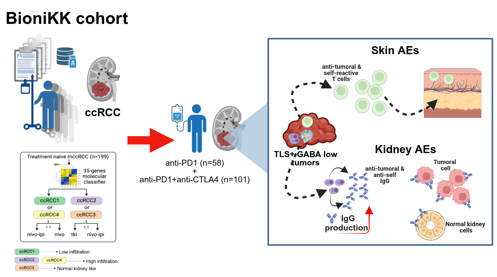

# AEs---BIONIKK
Code for reproducing analysis on the paper "Functional states of tertiary lymphoid structures determine response to immune checkpoint inhibitors and immune-related toxicity in metastatic clear cell renal cell carcinoma"

## Abstract
Background: Biomarkers capable of predicting both therapeutic benefit and adverse events (AEs) remain an unmet need in metastatic clear cell renal cell carcinoma (ccRCC). While tertiary lymphoid structures (TLS) have emerged as predictors of response to immune checkpoint inhibitors (ICIs), the relationship between TLS functionality, antitumor immunity and treatment-associated toxicity remains poorly understood.
Methods: We analyzed transcriptomic, pathological and clinical data from patients enrolled in the biomarker-driven phase II BIONIKK trial. Tumor transcriptomes were used to derive an immune gene signature (PRISMA), while whole-tumor immunohistochemistry was performed to quantify TLS maturation, immune infiltrates and tumor-bound Igs. Clinical outcomes, AE grading and kinetics and organ-specific toxicities were analyzed according to treatment arm, TLS status and intratumoral gamma-aminobutyric acid (GABA) levels.
Results: PRISMA identified immune-enriched tumors with the greatest benefit from nivolumab plus ipilimumab, whereas highly angiogenic tumors preferentially benefited from tyrosine kinase inhibitors (TKIs). PRISMA-high tumors contained significantly more immature TLS together with increased B cells, plasma cells and T-cells. Although TLS abundance or maturity alone did not predict survival, TLS-positive tumors with low intratumoral GABA displayed superior response rates and prolonged progression-free survival, supporting that TLS functionality rather than morphology as the key determinant of therapeutic efficacy. Treatment-related AEs (TrAE) were reported during the early phase of treatment and became less common over time, with severe grade ≥3 events occurring less frequently during nivolumab (N) monotherapy than under nivolumab-ipilimumab (NI) treatment. Overall TLS number was not associated with total AE frequency; however, patients with TLS-positive tumors were enriched for specific treatment-related toxicities, particularly skin, renal, endocrine and fatigue events. TLS-positive GABA-Low tumors exhibited the greatest cumulative renal and skin toxicity burden over time. High intratumoral CD8 infiltration and tumor-bound IgG were independently associated with increased rates of organ-specific AEs, whereas tumor-associated IgA exhibited a protective association for renal toxicity.
Conclusions: Our findings identify TLS functionality, rather than TLS abundance or maturation alone, as a major determinant of response to PD-1-based immunotherapy and organ specific TrAE. The GABA-TLS axis links productive antitumor immunity with selected immune-related toxicities, providing a framework for improving patient stratification to maximize therapeutic efficacy while limiting toxicity.
​​

## Citation
If you use any data or code derived from this study, please cite:

- Isaias Hernández-Verdin, Cheng-Ming Sun,et al. Functional states of tertiary lymphoid structures determine response to immune checkpoint inhibitors and immune-related toxicity in metastatic clear cell renal cell carcinoma.  Under revision (2026).
- DOI: Currently under revision.

## Code to reproduce main Figures
Visualize HTML files containing the code for each main figure by clicking on the coresponding links here:

 * [Figure 1. PRISMA ccRCC immune signature predict response to nivolumab + ipilimumab](http://htmlpreview.github.io/?https://github.com/iS4i4S/GABA-TLS/blob/main/Figures/Figure1.html): To reproduce this figure you need to download the needed metadata (Figure1_metaDat.csv) from the EGA..? (see Data avaliability below).

 * [Figure 2. PRISMA signature associates with TLS enrichment and improved response to nivolumab–ipilimumab, modulated by intratumoral GABA
](http://htmlpreview.github.io/?https://github.com/iS4i4S/GABA-TLS/blob/main/Figures/Figure1.html): To reproduce this figure you need to download the needed metadata (Figure2_metaDat.csv) from the EGA..? (see Data avaliability below).
 
 * [Figure 3 panel f and Figure 4 panels a-d](http://htmlpreview.github.io/?https://github.com/iS4i4S/GABA-TLS/blob/main/Figures/Figure1.html): To reproduce Figure 3 panel f and Figure 4 panels a-d you need to download the needed metadata (Figure3_metaDat.csv) from the EGA..? (see Data avaliability below).
 
* [Figure 3 panel a-e and Figure 4 panels e-g](http://htmlpreview.github.io/?https://github.com/iS4i4S/GABA-TLS/blob/main/Figures/Figure1.html): To reproduce Figure 3 panels a-e and Figure 4 e-g you need to download the needed metadata (Figure4_metaDat.csv) from the EGA..? (see Data avaliability below).

## Data avaliability
Needed data from the BioniKK cohort including clinical variables (OS, PFS, TST) as well as adverse events have been deposited on EGA under the accession ID [EGA](pending)

## Contact
E-mail any questions to [isaias.hernandez@sorbonne-universite.fr].

